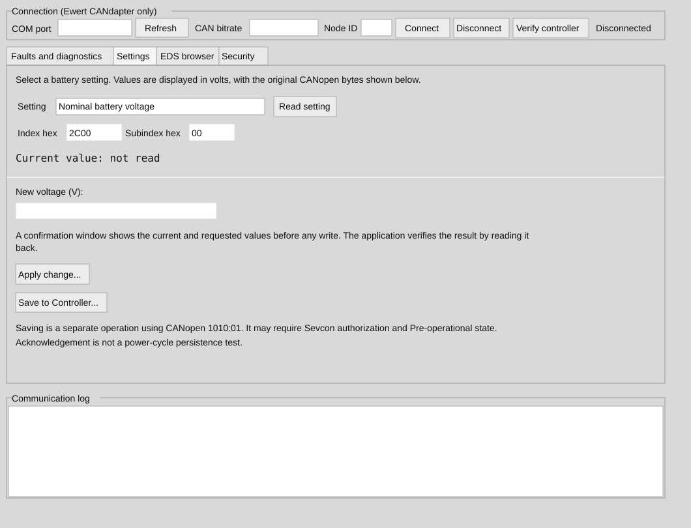

# Sevcon Gen4 CANdapter Utility

Cross-platform Python/Tkinter CANopen diagnostics and settings utility for Sevcon Gen4 controllers connected using either the **Ewert CANdapter** USB serial adapter or a **GVRET-compatible** USB-CAN interface.

> **Development prototype, not hardware validated.** Review the firmware's object dictionary / EDS before writing configuration. No guarantee of suitability for propulsion or safety-critical use.

## Interface preview

### Settings tab



*Illustration based on the current Tkinter controls; not a live-controller screenshot.*

## Features

- Select Ewert CANdapter or GVRET, serial port, CAN bitrate and CANopen node ID
- For GVRET, select CAN0 or CAN1 (where supported by hardware)
- Separate CANdapter link status from verified CANopen controller communication (fresh SDO identity request at 0x1018:01)
- Recheck controller communication with **Verify controller**; clear cached settings on disconnect
- Read CANopen identity, error register and **individual active Sevcon fault IDs**, and request **controller-provided text descriptions** (0x5300 / 0x5610)
- Read predefined battery protection thresholds, displaying volts alongside raw values
- Explicit write confirmation, read-before-write, and read-back verification
- Export collected diagnostics to CSV
- Communication log; supports manual SDO access

Active Sevcon fault descriptions are retrieved directly from the controller when supported by its firmware. Stored fault-log decoding and access unlocks are not implemented. The fault reader uses limited segmented SDO uploads for text descriptions (up to 4096 bytes). Fault selector SDO writes only change diagnostic selection, not fault storage or settings. Saving parameter changes across power cycles is not implemented. Controller-specific object mapping/scaling must be independently verified before applying writes.

## Run from source

Requires Python 3.10+ and Tkinter; `python3-tk` may be required on Linux.

```bash
python -m pip install -r requirements.txt
python sevcon_ui.py
```

Windows may use `py` instead of `python`.

## Download a Windows build

GitHub Actions builds a 64-bit Windows executable from `main` using the [Build Windows executable](../../actions/workflows/build-windows.yml) workflow. Open the latest successful workflow run and download the **SevconGen4-Windows-x64** artifact under **Artifacts**. Extract `SevconGen4.exe` from the ZIP; no Python installation is required to run that executable. You can also trigger the workflow manually using **Run workflow**.

The workflow checks Python syntax and runs unit tests before packaging. An uploaded artifact means packaging completed, **not** that CANdapter or GVRET hardware has been tested. Windows may display an unsigned-app warning.

## Package for your OS

Install `pyinstaller` in your build environment, then build on the target OS:

```bash
python -m pip install pyinstaller
python -m PyInstaller --onefile --windowed --name SevconGen4 sevcon_ui.py
```

On macOS, a normal `--windowed` build can produce an app bundle. PyInstaller cannot cross-compile between Windows, Linux and macOS.

## Safety

Start read-only, with the propeller disabled and motor prevented from starting. Verify the CAN wiring and termination. Do **not** reduce controller voltage protection below safe limits. Never assume a successful CANopen write has been stored nonvolatilely. No BMS is present on some installations; appropriate independent battery protection is essential.

## Status

Python syntax validated only; no live CANdapter/Sevcon testing completed. This repository is an experimental starting point.

## EDS object dictionary browser

Open the **EDS browser** tab and choose **Open EDS…** to load your controller's firmware-matched CANopen Electronic Data Sheet (`.eds`). Search the index or object name, select a parameter and choose **Read selected**.

The browser displays the EDS description, data type, access flags, default and declared limits. CANopen INTEGER8/16/32, UNSIGNED8/16/32, BOOLEAN and REAL32 values are decoded into numbers. Unsupported types (including strings, domain data and segmented transfers) are not written. EDS numeric types are **not** automatically converted into engineering units such as volts or amps: manufacturer-specific scaling requires independent verification. The existing Battery Settings tab continues to use its documented voltage conversions.

EDS entries marked writable may be edited only after a successful live read, explicit confirmation and identical read-back. Objects marked read-only cannot be edited. Actual Sevcon authentication, firmware limits, operational-state requirements and persistent saving are independent of EDS permission flags. **Back up controller configuration and keep propulsion disabled before writing settings.**

Tests: `python -m unittest discover -s tests -v`
## Adapter backends

The CANopen request/response logic in `sevcon_ui.py` now uses the common adapter contract supplied by `can_adapters.py`. The Ewert ASCII and GVRET binary implementations expose the same `send()`, timestamped SDO reply queue, transaction lock and close methods. GVRET supports CAN0/CAN1 selection; serial mode uses 1,000,000 baud and device binary validation before CANopen verification. Its selected channel is configured at the chosen CAN bitrate. GVRET serial variants may need flow-control adjustments depending on firmware. This is an initial implementation and must be tested with a physical GVRET device before relying on it for configuration writes.

## Communication verification

**Connect** opens the Ewert CANdapter serial link and then requests CANopen identity object `0x1018:01` using the selected node ID. The status first reports **CANdapter open — controller unverified**; only a valid SDO response changes it to **Controller verified**. An adapter acknowledgement by itself does not prove controller communication. Use **Verify controller** to repeat the request. A timeout reports controller not responding; check CAN bitrate, node ID, wiring and power. Status verification is a point-in-time check, not ongoing heartbeat supervision. The app has not yet been hardware-tested.

## Save to Controller (nonvolatile store request)

The **Settings** tab has a separate **Save to Controller…** button. It requires a successfully verified controller connection and an explicit confirmation. It sends the standard CANopen store signature (ASCII `save`, little-endian value `0x65766173`) to object `0x1010:01` via an expedited SDO write. The app never invokes this automatically after changing a parameter.

A positive SDO response means the store request was acknowledged, **not** that nonvolatile retention was independently verified. Safely power-cycle and reread parameters to verify persistence. The controller may reject this request because of its security access level or required NMT state; the app does not bypass access or change NMT state automatically. Use only with the motor disabled.

## Security tab (read-only)

The **Security** tab offers **Refresh security information** to read Sevcon access level `0x5000:01`, controller operational-state diagnostic `0x5110:00`, and detailed error reason `0x5310:00`. Results include raw values; unknown and unsupported values are not guessed. Individual read failures are shown without interrupting the others. This tab never authenticates, changes NMT state or alters controller parameters. Object availability and semantics depend on firmware.

## CAN communication hardening

Both adapters queue only SDO replies, with a bounded receive queue and timestamped messages. SDO requests are serialized; replies must match the selected node and CANopen index/subindex. Segmented reads validate toggles and response lengths. After an SDO timeout, the next request has a cooldown to reduce the risk of late responses being mistaken for new ones. The serial port, bitrate and node ID are locked while connected. A controller verification read is still point-in-time; continuous bus supervision and physical hardware tests are not yet implemented.

## Security authorization

Security tab now supports optional **Authorize…** using a controller-specific **pre-encoded** response entered as hexadecimal (1, 2 or 4 bytes), and optional user ID. The UI masks the response and clears it immediately after submission. It writes optional user ID to `0x5000:03`, then the provided response to `0x5000:02`, and reads `0x5000:01` to display the resulting security level. The tool does **not** derive the response from a plain password, discover keys, bypass access or change NMT state. A compatible authorization value and object layout must be supplied for the actual firmware; authentication remains untested on hardware. Invalid attempts may be rejected or logged by the controller.

Protocol tests: `python -m unittest discover -s tests -v`. Both backends require live hardware verification; especially GVRET serial-port behavior and bus configuration.
